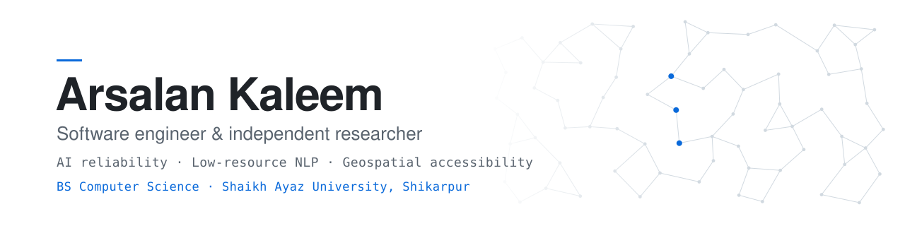

<picture>
  <source media="(prefers-color-scheme: dark)" srcset="assets/banner-dark.svg" />
  
</picture>

# Arsalan Kaleem

I'm a software engineer and independent researcher, studying for my BS in Computer Science at **Shaikh Ayaz University, Shikarpur**, Sindh, Pakistan.

I like problems where the standard answer turns out to be wrong. Most of my work checks a common method against real data, and I publish the code, the data and the cases where it fails. Each project below starts with the one thing it adds that wasn't there before.

[Portfolio](https://arsalankaleem.github.io/portfolio/) · [ORCID](https://orcid.org/0009-0002-9054-6965) · [Hugging Face](https://huggingface.co/ArsalanKaleem) · [LinkedIn](https://linkedin.com/in/arsalankaleem) · [Email](mailto:arsalanabbasi.here@gmail.com)

---

## Research

**AI reliability and safety**

- [**TraceWarden**](https://github.com/ArsalanKaleem/tracewarden): a firewall that scores each tool call an LLM agent proposes *before it runs*, points to the tool output the prompt injection came from, and keeps false alarms within a set budget using conformal calibration.
- [**swe-inject**](https://github.com/ArsalanKaleem/swe-inject): a benchmark that labels prompt injection against coding agents at the level of individual steps. I used it to show that guards trained on synthetic data fail on real agents.
- [**unlearning-audit**](https://github.com/ArsalanKaleem/unlearning-audit): a preregistered audit of LLM unlearning that compares against a set of facts the model was never taught, so "forgotten" can be measured against "never known".
- [**debiasability-curve**](https://github.com/ArsalanKaleem/debiasability-curve): varies how strong a spurious correlation is to test whether trimming sparse-autoencoder features actually removes a concept.

**Low-resource NLP (Sindhi and Urdu)**

- [**LAFZ**](https://github.com/ArsalanKaleem/LAFZ): extends an open LLM's vocabulary after training. Urdu and Sindhi text needs 47–49% fewer tokens and generation runs about 1.9× faster.
- [**MorphoTok-SD-UR**](https://github.com/ArsalanKaleem/MorphoTok-SD-UR): a preregistered study of morphology-aware tokenization with gold data from native Sindhi speakers. It is also the home of [**SindhiNorm**](https://pypi.org/project/sindhinorm/), a spelling normalizer for Sindhi checked against native speakers (`pip install sindhinorm`).
- [**sindhi-JEV**](https://github.com/ArsalanKaleem/sindhi-JEV): a 7M-parameter checker that flags wrong Sindhi OCR output and marks where the error is.

**Geospatial accessibility in Sindh**

- [**SWAI**](https://github.com/ArsalanKaleem/Sindh-Water-Access-index-SWAI-): drinking-water access for 5,159 villages. It shows that using annual rainfall in the standard method flips the ranking, so the driest districts come out looking best served.
- [**RHAI**](https://github.com/ArsalanKaleem/Rural-Healthcare-Accessibility-Index--RHAI-): travel time to the nearest health facility over the real road network, plus a measure of how much incomplete open data distorts the result.
- [**flood-recovery-sindh**](https://github.com/ArsalanKaleem/flood-recovery-sindh): matched-counterfactual satellite analysis of 555k cropland cells after the 2022 floods.
- [**FHARI**](https://github.com/ArsalanKaleem/FHARI) · [**CODA**](https://github.com/ArsalanKaleem/CODA): health access when roads flood, and whether flood losses and chronic shortages of water, health care and market access hit the same villages.

## Publications

- **Kaleem, A.**, Soomro, S., Jan, U., Haseja, S. (2026). *Estimating village-level drinking-water accessibility in Sindh, Pakistan, from open geospatial data: why annual rainfall inverts the ranking.* International Journal of Advanced Research. [doi:10.5281/zenodo.24134151](https://doi.org/10.5281/zenodo.24134151)
- **Kaleem, A.** (2026). *What open geospatial data can and cannot tell us about geographic access to rural public primary care.* International Journal of Advanced Research, 3(5), 1606–1624. [doi:10.5281/zenodo.22828857](https://doi.org/10.5281/zenodo.22828857)
- **Kaleem, A.** (2026). *Synthetic-trained guards fail on real LLM agents: step-level evidence from tool-use and coding-agent prompt injection.* Preprint. [doi:10.20944/preprints202611.0859.v1](https://doi.org/10.20944/preprints202611.0859.v1)
- **Kaleem, A.** (2026). *Post-hoc vocabulary extension for low-resource languages: gains beyond fine-tuning, a pre-tokenizer limit, and effects on degenerate generation.* Preprint. [doi:10.20944/preprints202610.2314.v1](https://doi.org/10.20944/preprints202610.2314.v1)
- **Kaleem, A.** (2026). *Seasonally decoupled recovery of flooded cropland after the 2022 Sindh floods: a matched-counterfactual satellite assessment.* Preprint. [doi:10.20944/preprints202610.1600.v1](https://doi.org/10.20944/preprints202610.1600.v1)

## Open data and software

| Resource | Type | Link |
| --- | --- | --- |
| swe-inject-steps | Dataset · Hugging Face | [huggingface.co/datasets/ArsalanKaleem/swe-inject-steps](https://huggingface.co/datasets/ArsalanKaleem/swe-inject-steps) |
| Sindh Water Access Index (SWAI) | Software and data · Zenodo | [10.5281/zenodo.21422759](https://doi.org/10.5281/zenodo.21422759) |
| sindhinorm | Python package · PyPI | [pypi.org/project/sindhinorm](https://pypi.org/project/sindhinorm/) |
| SindhiNorm / MorphoTok-SD-UR | Software · Zenodo | [10.5281/zenodo.24093293](https://doi.org/10.5281/zenodo.24093293) |

## Engineering

I also build and ship apps, mostly with Flutter, Firebase and Python:

- [**Documentum**](https://github.com/ArsalanKaleem/Documentum): writes a project's documentation using parallel AI agents and several LLM providers.
- [**Gloria**](https://github.com/ArsalanKaleem/Gloria): an open-source RAG assistant for universities (hybrid BGE + BM25 search), built for Shaikh Ayaz University.
- [**SIMUL**](https://github.com/ArsalanKaleem/simul-watch-together-app): watch YouTube in sync with others, with video chat and screen sharing.
- [**Aestimo**](https://github.com/ArsalanKaleem/Aestimo) · [**F1-Vision**](https://github.com/ArsalanKaleem/F1-Vision) · [**Nuntius**](https://github.com/ArsalanKaleem/Nuntius) · [**ForgeOS**](https://github.com/ArsalanKaleem/forge-os)

Python · PyTorch · Hugging Face · Earth Engine · GeoPandas · OSMnx · FastAPI · Flutter · Dart · Firebase · Docker
